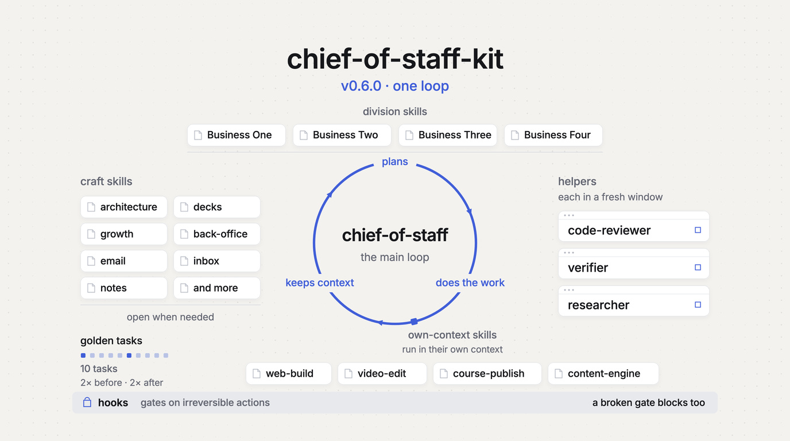

# chief-of-staff-kit

**One chief of staff for Claude Code and Codex.** It is a single main loop that
plans the work, does the work and keeps the context. Your divisions and crafts are
**skills** it opens when it needs them, three **helpers** run in their own window
when a separate context changes the result, **hooks** hold the actions you never
want taken without a yes, and **ten golden tasks** tell you whether a change
helped. A short interview fits all of it to your work. No two installs look the
same.



---

## Explore the live system

[Open the live, read-only BluPlai whiteboard](https://app.bluplai.com/public/whiteboards/wb_haSCnp3ySzExZDzSiJeIhpqh41P89AAGQj83QvplK1o)
to explore the native, editable release workflow from the private AIOS to the public
kit. It needs no BluPlai account, and changes to the board appear there live.

---

## What you get

```
                          chief-of-staff               ← the main loop: plans, does the work, keeps the context
                                │
      loads a skill when needed ┼ calls a helper only when a separate context changes the result
                                │
  division skills    Business One · Business Two · …   ← facts, people, voice, filing, open work
  craft skills       architecture · program-plan · problem-solving · decks · voice-scripts · growth
                     product-design · back-office · email · inbox · notes · memory-harvest
  own-context skills web-build · video-edit · course-publish · content-engine   ← run in their own context
  helpers            code-reviewer · verifier · researcher                       ← fresh window
  hooks              gates on your irreversible actions (a broken gate blocks too)
  evals              golden-tasks.md: ten tasks, run twice before and after any change
```

A **division** is whatever unit you run: a business, a department, a team, a
product line, a client book, or a person you manage. Each one becomes a skill:
the main loop sees a one-line summary and opens the full file (facts, people,
voice, filing, open work) only when the work touches it.

| Piece | What it is | Why it is that and not an agent |
|---|---|---|
| **chief-of-staff** | The main session (`claude --agent chief-of-staff`) | It holds the conversation from the first message to the result, so nothing is lost in a hand-off |
| **Division skills** | One per division, short, with referenced files | The division's knowledge is needed *in* the loop, not in a separate window |
| **Craft skills** | Twelve procedures: decks, email, back office, growth… | A procedure the main loop follows needs no context of its own |
| **Own-context skills** | Four tool-heavy jobs with `context: fork` | Their tool output (builds, renders, uploads) would flood the main window |
| **code-reviewer** | Fresh window, spec and diff only, `effort: high` | The builder's context would hurt: it shares the builder's blind spots |
| **verifier** | Drives the browser or app, knows only the user flow | Same reason: it checks what a user sees, not what was meant |
| **researcher** | Clean-window research helper | It needs nothing from the main loop, and its raw reading stays out |
| **Hook gates** | PreToolUse hooks with `"onFailure": "block"` | Hard rules in prose get forgotten; a hook runs every time |
| **golden-tasks.md** | Ten tasks with "done" lines | So "this is better" is a score, not an opinion |

## Why one loop

Up to v0.5.0 this kit installed an org chart: a chief of staff that routed to a
lead per division, and leads that pulled in specialists. Every hop was a
hand-off, and hand-offs drop decisions. In the author's own use, the generic
helpers, forks and the code reviewer did almost all of the delegated work; the
named division leads were almost never called.

Anthropic's article [*Building agents: When to fold subagents into your main
agent loop*](https://claude.com/resources/articles/building-agents-when-to-fold-subagents-into-your-main-agent-loop)
(22 October 2026) names the same failure modes in larger systems: context lost
at each hand-off, subagent sprawl, the "Frankenprompt" of conflicting rules,
evals that test one piece only, and latency (one customer's single loop ran
roughly twice as fast). Its rule is the one this kit now follows: fold a
subagent in, and keep it as a subagent only if the folded version scores worse.

**The one question before any helper:** does what the main loop already knows
**help, hurt, or not matter**?

- **Helps** → do it inline. This is the usual answer.
- **Hurts** → a fresh reviewer (`code-reviewer`, `verifier`).
- **Does not matter** → a clean-window helper (`researcher`).
- **Several truly independent heavy jobs** → forks in parallel; five or more
  becomes a workflow.

Three recent Claude Code changes make this practical:

- **Fork helpers** (on by default in `-p`, the SDK, desktop and VS Code from
  2.1.302; in the terminal from 2.1.232). A fork inherits the whole
  conversation and shares its prompt cache, but its tool calls stay out of the
  main window. `/subtask <task>` starts one by hand.
- **Skills survive compaction** (2.1.304). The skill list is sent again after
  compaction, so a long session keeps its divisions and crafts. Invoked skill
  bodies are re-attached up to 5,000 tokens each and 25,000 in total, which is
  why every skill here is short with detail in referenced files.
- **Effort per helper** (2.1.292). The main loop can run the reviewer at `high`
  and a quick lookup at `low` without a separate agent per effort level.

And hooks with `"onFailure": "block"` (2.1.295) mean a broken or slow gate
blocks the action instead of letting it through.

## Install in Claude Code

You need [Claude Code](https://claude.com/claude-code) 2.1.295 or later for
every feature above (earlier versions install, without them). Add the plugin:

**Terminal:**

1. Add the marketplace:
   ```text
   /plugin marketplace add skyremote/chief-of-staff-kit
   ```
2. Install the plugin:
   ```text
   /plugin install chief-of-staff-kit@skyremote
   ```
   (Or run `/plugin`, choose **Browse marketplaces**, and install **chief-of-staff-kit**
   from the menu.)

**Claude desktop app:** open **Code** for a local workspace. In **Customize →
Plugins → Add plugin → Add marketplace → Add from a repository**, enter
`https://github.com/skyremote/chief-of-staff-kit`. Install
**chief-of-staff-kit** from that marketplace and start a new local Code session.

Then tell Claude **`install the crew`**. The installer reads your existing
`CLAUDE.md` (or interviews you), asks which actions must never happen without
your yes, and shows you the whole plan, including the exact hooks block it will
add to your settings. Nothing is written until you approve; your settings file
is backed up first. Start a new session and run `claude --agent chief-of-staff`.
The installer can also make it the default local session if you choose.

The local Code tab shares Claude Code's local configuration. Chat, Cowork and
cloud sessions load extensions differently; check those surfaces separately.

## Update an existing crew

```text
/plugin marketplace update skyremote
/plugin update chief-of-staff-kit@skyremote
/reload-plugins
/chief-of-staff-kit:update-crew
```

Updating the plugin does not rewrite your crew. **If you run a v0.5 crew**,
`update-crew` offers the migration to one loop and does it the measured way:

1. **Audit** every agent: fold (becomes a skill), merge (two roles that always
   run together), call as a tool (keeps its own context, returns a compact
   result) or keep (its context must differ).
2. **Back up** the whole crew, with a `RESTORE.md`, before the first change.
3. **Baseline** your ten golden tasks, twice.
4. **Fold one role at a time,** re-run the tasks twice, and keep the change only
   if it scores at least as well. Otherwise that role is restored.

You can stop at any point; a crew with some roles folded is fine. You can also
stay on agents: the updater still applies the current frontmatter rules. For
larger agent systems, Anthropic's
[single-agent-loop-kit](https://github.com/anthropics/single-agent-loop-kit)
runs the same audit with scripts.

In the desktop app, update the plugin in **Customize → Plugins**, start a new
local Code session, then run `update-crew` there. See `CHANGELOG.md` for what
each version changed.

**Hand-copied crew (no plugin installed)?** Clone or pull this repo, point Claude
at `skills/update-crew/SKILL.md` in your clone, and run it: it updates the crew
you actually have and preserves your customisation the same way.

To configure Anthropic's advisor primitive after updating, run:

```text
/chief-of-staff-kit:advisor
```

### Manual install (no marketplace)

```bash
git clone https://github.com/skyremote/chief-of-staff-kit
cp -r chief-of-staff-kit/skills/install-crew ~/.claude/skills/
```

Then ask Claude to **install the crew**.

## Codex

Clone this repository, open your target workspace in Codex, and ask Codex to read
`skills/install-crew/SKILL.md` from the clone and install the crew for Codex.
The root session takes the main-loop doctrine from a team section in `AGENTS.md`,
skills go to `.agents/skills/`, and the helpers and the four heavy jobs become
custom agents under `.codex/agents/`. Codex hooks have no `ask` and no
`onFailure`, so its gates always deny, and a gate that errors lets the action
through; the installer says so and asks you to review the hooks with `/hooks`.

## The legacy shape

If you prefer the v0.5 shape (an orchestrator routing to division-lead and
specialist agents), ask the installer for it. The templates are kept unchanged
under `skills/install-crew/templates/legacy/`, and hook gates and golden tasks
work with either shape. Run the golden tasks against both before you settle.


## What's in here

```
.claude-plugin/        plugin + marketplace manifests
skills/install-crew/
  SKILL.md             the installer (interview → plan → render → test)
  templates/
    main-loop.md       the chief of staff
    skills/            division skill, craft skills, own-context skills
    agents/            code-reviewer, verifier, researcher
    hooks/             example gate scripts
    evals/             golden-tasks.md
    legacy/            the v0.5 agent templates, unchanged
  references/          how to render for Claude Code and Codex
skills/update-crew/    in-place updater and v0.5 → one-loop migration
skills/advisor/        advisor adoption and verification runbook
assets/                README art
```

Everything is Markdown, plus three POSIX shell gate scripts. There is no build
step; the installer follows
[`skills/install-crew/SKILL.md`](skills/install-crew/SKILL.md).

## License

[MIT](LICENSE). Use it, fork it, make it yours.
